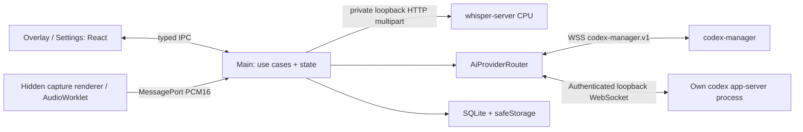

# Архитектура

`domain` содержит типы, порты, правила FIFO и составление prompt. `application` управляет интервью и независимыми задачами capture/STT/AI; UI не является источником бизнес-состояния. `adapters` изолируют платформенные API, процесс Whisper, сеть и хранилище. `main` — точка композиции. `shared/ipc` задает ограниченный preload API; входные команды проверяются Zod.

Слот очереди резервируется до запроса устройств. Лимит включает запись, STT, очередь и генерацию. Следующий готовый текст не может обойти предыдущую запись. STT и AI могут работать одновременно, но внутри каждого этапа допускается одна операция. На ошибке STT уже распознанные сегменты сохраняются в `review` с отметкой частичного результата; текст не отправляется автоматически. Отмена не удаляет историю.

Уход из интервью приостанавливает локальную обработку и сохраняет outbox для последующей сверки. Он не требует reconnect и не означает подтверждённую отмену удалённой генерации. Для готовой idle cloud-сессии выполняется best-effort close с пределом 1 секунда; поздний ответ старого подключения не должен отключать новое. При восстановлении native turn его items заполняют блоки перед накоплением следующих дельт.

`Interview.id` — локальная сущность; `remote.sessionId` заменяется после завершения/истечения удаленной сессии. Профиль, провайдер, модель и endpoint фиксируются при создании интервью. Перед повторной отправкой команда хранится с исходным payload и clientRequestId. Курсор и изменения вопроса применяются транзакционно. Полные item.text заменяют блоки, окончательный finalResponse заменяет промежуточный ответ.

Серверный профиль `interview-assistant@2` использует постоянный Codex App Server внутри worker и преобразует его текстовые дельты в полные блоки существующего WebSocket-протокола. Клиент по-прежнему заменяет блок по ID и использует окончательный `turn.completed.finalResponse`. Облачные инструкции runtime хранятся в профиле. В локальном режиме независимый LocalCodexClient запускает собственный установленный codex app-server и использует эквивалентные инструкции. Публикация V2 влияет на новые удаленные сессии, существующие сохраняют прежнюю конфигурацию. Метрики первого текста и полного ответа описаны в [latency.md](latency.md).

Сервер не выдает новый session.ready при reconnect: адаптер сверяет REST и проверяет протокол ping/pong. В состоянии session.queued разрешается turn.start. После terminal события учитывается задержка перехода сервера в IDLE. Неопределенно принятый turn не переносится в другую сессию автоматически, поскольку идемпотентность сервиса ограничена sessionId.

SQLite хранит отдельные записи интервью, версий вопросов (включая ответ и сегменты), настроек, секретов и outbox. Каждая содержательная запись — зашифрованный blob; ID и порядок остаются индексируемыми. WAL и транзакции обеспечивают согласованное восстановление. Ревизия вопроса получает новый ID со ссылкой revisionOf; предыдущая запись сохраняется.

Аудиодорожки имеют источник и общий отсчет времени; пользовательские роли из меток автоматически не выводятся. Главный процесс не воспроизводит звук и не выполняет DSP. Renderer создает 100-мс пакеты 16-kHz PCM16, ограничивает длительность, проверяет последовательность и освобождает tracks. Whisper загружается один раз и получает WAV в памяти, а его stdout/stderr не сохраняются, поскольку могут содержать речь.

Для новых ОС добавляются адаптеры захвата/окон. Для другой STT-модели заменяются ресурсы и SttPort; для другого AI-транспорта — AiSessionPort. Расширения не должны добавлять Node, файловую систему или сетевой клиент в React renderer.

SQLite user_version=2 транзакционно добавляет облачный провайдер старым настройкам, интервью и outbox. RemoteSession хранит облачные sessionId/lastSequence или локальные threadId/cliVersion; адаптер выбирается только по Interview.provider. CloudAiClient получает секрет через SecretStore. AiSessionPort не принимает облачный токен.

Проверка сохранённых настроек использует отдельный транспорт и AiReadiness, не изменяя состояние текущего интервью. Локальная проверка не создаёт thread; облачная открывает и закрывает пустую служебную серверную сессию без локального интервью и без turn.start. Подробности native outbox и восстановления: [local-codex.md](local-codex.md).
